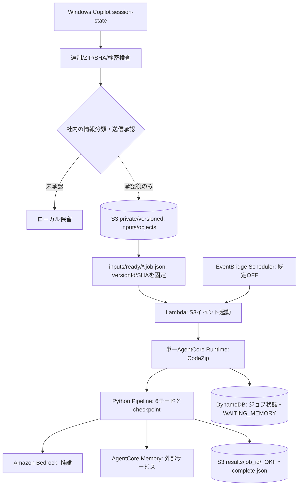

# Copilot Self-Learning Platform — アーキテクチャ v2

更新: **2026-11-15 / PR #27まで**。単一AgentCore Runtime（CodeZip）のコードと合成E2Eは実装済みですが、**AWSへは未デプロイ**。初期の「S3保存のみ」のPhase 0設計とは異なります。Managed Harnessは使用しません。

## 全体構成



**「Runtime 1つ」は実行環境が1つの意味**で、すべてのMemory/実験条件を混在させる意味ではありません。Lambdaはセッション本文ではなく固定ジョブ参照を送ります。HTTP 202は受付であって完了ではなく、S3の`complete.json`とDynamoDBの`SUCCEEDED`で確認します。

## 実コードとの対応

| 役割 | 実装先 | 状態 |
|---|---|---|
| セッションのローカル選別 | `scripts/prepare_sessions.py` | 合成入力で検査、実Copilot書式未確認 |
| Runtime HTTP入口 | `main.py` / `runtime_service/server.py` | `/ping`・`/invocations`・worker |
| 許可設定・S3/Memory/LLM | `runtime_service/contracts.py` / `aws_adapters.py` | VersionId/SHA/KMS/許可モデルを照合、実通信停止 |
| 6モード統合 | `runtime_service/pipeline.py` | 独自抽出、Memory、Wiki、OKF |
| 起動・有限回再開 | `lambda_function.py` / `runtime_service/trigger.py` / `resume.py` | 同じLambda／Runtime、Scheduler既定OFF |
| 知識抽出と安全判定 | `copilot_learning/learning.py` | Note/Skill候補・反証・Grade |
| Wiki/OKF | `copilot_learning/wiki.py` / `okf.py` | WM/WOの出典/脚注/版検査 |
| 比較計画 | `experiment_suite.py` / `wiki_matrix.py` | **13×3＝39条件の準備計画のみ** |

## 単一Runtimeの6モード

| mode | 実行経路 |
|---|---|
| `custom` | 原本→独自抽出→Grade |
| `original_wiki` | 原本→Bedrock用Wiki候補→引用検査→OKF |
| `custom_and_original_wiki` | 同じ原本から独自抽出と原本Wiki（Memoryなし） |
| `memory_ingest` | 原本→AgentCore Memory投入 |
| `memory_wiki` | Memory投入・取得→**暫定**Wiki→OKF |
| `hybrid` | Memory取得結果→独立Grade |

6モードのモック統合は、39条件の公平な実験を完了したことを意味しません。Memoryの`CreateEvent`受理や`ListMemoryRecords`の安定した複数回読取は**非同期抽出/Reflection完了の証拠ではありません**。

## 入出力・再開

```text
inputs/objects/              セッションZIP・manifest・任意feedback（VersionId/SHA）
inputs/ready/*.job.json      最後に置く起動ファイル
results/<job_id>/            checkpoints、暫定知識、OKF、complete.json
DynamoDB                   RUNNING / SUCCEEDED / FAILED / WAITING_MEMORY
                           上限・条件異常 → RECOVERY_REQUIRED
```

Memory待ちはGSIの候補を本体の強整合読取で再確認し、revision/期限を照合してScheduler→**同じLambda**→**同じRuntime**へ送ります。`EnableMemoryResume=false`とS3通知OFFが既定。`FAILED`や期限切れ`RUNNING`を無条件再実行しません。API成功直後・checkpoint前の強制停止までexactly-onceを保証しません。

## 安全性と残課題

`require_online_release()`はAWS実送受信を無条件停止します。フラグでは解除不可。公開Gitへ社内セッション・承認履歴・鍵・機密辞書を保存しません。ARM64/AL2023実起動、CFN/IAM/KMS、Scheduler/GSI/S3通知の実動作、実LLM/Memory/Copilot、社内SSO/DLPは未検証です。Wikiは`draft`、`approved_for_copilot=false`で、39条件runner/費用実測/安全なCopilot自動適用も未完成です。

次に読む資料: [現在地](current-status-20261115.md)、[Runtime/CodeZip](single-runtime-codezip-20261115.md)、[Memory再開](memory-resume-20261115.md)、[比較実験](full-experiment-suite-20261115.md)、[Wiki/OKF](okf-wiki-20261115.md)。
