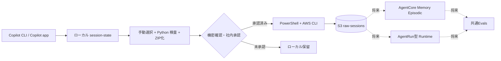

# Architecture / 要件定義 v1.1（段階導入）

更新日: 2026-11-14。既存のv1.0提案から、**リアルタイムHook収集を初期必須要件から外し、終了済みセッションの後日一括取得を最初の実装単位**に変更。

## 目的・スコープ

普段のCopilot開発から生まれた経験を、後で学習・比較できるように蓄積する。最初は**人が選んだローカルセッションをS3へ保存するのみ**で、LLM学習、AgentCoreへの送信、Copilot Skillsの自動書換えはしない。



## Phase 0 / 1 の機能要件

| ID | 内容 | 受入条件 |
|---|---|---|
| R-01 | Windows標準環境（WSL2/Dockerなし）で動作 | PowerShell 5.1+、Python 3.10+、AWS CLI v2 |
| R-02 | 既存セッションの一覧表示・明示的選択 | `--list` と `--session` / `--all` を実装 |
| R-03 | 終了済みセッションだけローカル梱包 | 最終更新から30分未満を既定で拒否 |
| R-04 | データは元の形式で保存 | `events.jsonl`、存在すれば `workspace.yaml`、`plan.md` をZIP化 |
| R-05 | 梱包後にハッシュとmanifestを生成 | 再梱包で同じZIP、ZIPとmanifestのSHA照合可能 |
| R-06 | 既知の秘密情報を検知して梱包を拒否 | 主要トークンや秘密鍵の疑いを検出。完全なDLPではない |
| R-07 | Gitの管理下に生データを書き出さない | `--out` がGitリポジトリ内なら拒否 |
| R-08 | S3は既定で送信しない | PowerShellを実行しても既定はDry Run |
| R-09 | 実送信時は会社の承認・AWSアカウント・KMSを指定 | `-Upload -ConfirmApprovedData` が必須、STSでアカウント照合 |
| R-10 | 同じ入力による上書きを避ける | content fingerprint + `If-None-Match: *`、既存ハッシュ照合 |
| R-11 | 将来の学習器が同じ入力を使える | スキーマ版、SHA、元セッションIDのハッシュを記録 |
| R-12 | Human feedbackは後から紐づける | `session_fingerprint` に紐づけるJSON形式を提示 |

### 初期収集に含めない情報

`checkpoints/`、`files/` 等の成果物、`session-store.db`、`logs/`、ツール外のGit差分、ユーザーの評価は現時点では自動収集しない。**これらの情報を後から完全復元できるとは限らない。** 重要な訂正や実験結果は別途フィードバックとして記録する。

### S3の保存契約

```text
s3://<会社承認バケット>/copilot-learning/v1/
  raw-sessions/<session_fingerprint>/
    session.zip           # 元のセッションデータを保存
    manifest.json         # 構造・ハッシュ・確認状態
  feedback/               # 次段階で投入
  knowledge/
    memory/               # A: AgentCore Memory の抽出結果
    agentrun/             # B: AgentRun型
    hybrid/               # C: ハイブリッド
  evaluations/            # 同一入力に対する比較・評価
```

`session_fingerprint` は内容から決定するため、同一内容の再送は同じキーになる。S3はrawの正本であり、Memoryの記憶リソースとは別物。MemoryやRuntimeに直接ZIPを渡して学習するわけではなく、将来、JSONLから必要なイベントを正規化するインジェスタを実装する。

## セキュリティ方針

- このGitHubリポジトリは**公開**。セッション、トークン、AWSアカウント情報、社内コードをコミットしない。
- `.gitignore` は事故軽減策であり、意図的な `git add -f` や別名での混入を防げない。
- セッション内には会話全文・コード・ツール応答などが含まれ得る。**パターン検査だけでは、機密や個人情報を十分に検出できない**。担当者が内容を確認して社内承認後にのみS3へ送る。
- S3はBlock Public Access、会社管理のIAM、KMS鍵、保持期限、監査ログを適用する。アカウントIDや鍵・バケットはコードに固定しない。
- 初期スクリプトはAWSリソースを自動作成せず、既存の社内承認済みバケットだけを使う。
- 誤送信した場合はS3のバージョンを含めた削除・漏えいインシデント手順を会社規程に従い実行する。

## 将来のA/B/C比較

- **A** AgentCore Memory（Episodic）：セッションをイベントに変換し、Memory APIへ順番に取り込む。非同期のReflectionを取得してS3に正規化保存。
- **B** AgentRun型：S3から同一イベントを読み、RuntimeでReflection→Check→Gradeを独立実装。
- **C** ハイブリッド：Aの出力にBの独立評価器を適用。
- **D** 知識なし：改善効果を実測するための評価用対照群。

最初の比較では入力データ・評価ルーブリックを固定し、知識品質・重複率・誤採用率・コストを測る。次に未知のCopilot課題で成功率・再発率・ツール呼び出し回数の改善を検証する。モデル重みの学習は行わない。

## 次に実装するIssue候補

1. `LEARN-A`: S3 JSONL→AgentCore Memoryイベント形式への正規化と `IngestData` / Episodic Reflectionの取得。
2. `LEARN-B`: AgentRun型 Reflection・Check・Grade。
3. `LEARN-C`: Memory出力の独立評価。
4. `FEEDBACK`: UI/CLIから人間の評価結果をS3に送信。
5. `EVAL`: ブラインド評価、費用、改善効果のレポート。

## 参考公式資料

- [Copilot CLIのローカルセッションデータ](https://docs.github.com/en/copilot/reference/copilot-cli-reference/cli-config-dir-reference)
- [Copilotのセッションデータ](https://docs.github.com/en/copilot/concepts/security-governance-and-network-settings/session-data)
- [S3 PutObject（条件付き書き込み）](https://docs.aws.amazon.com/cli/latest/reference/s3api/put-object.html)
- [AgentCore Memory](https://docs.aws.amazon.com/bedrock-agentcore/latest/devguide/memory.html)
